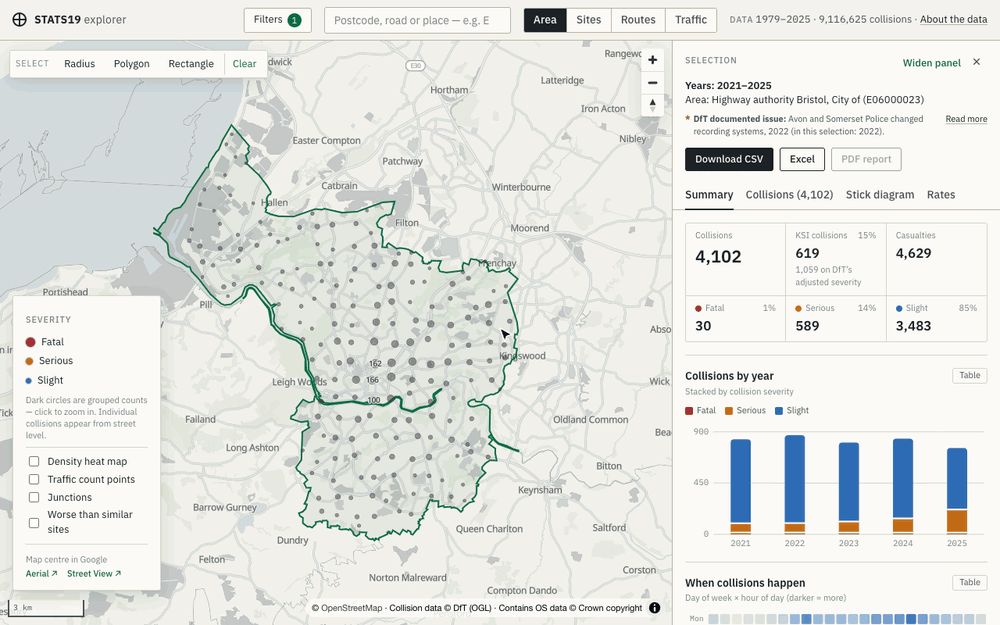
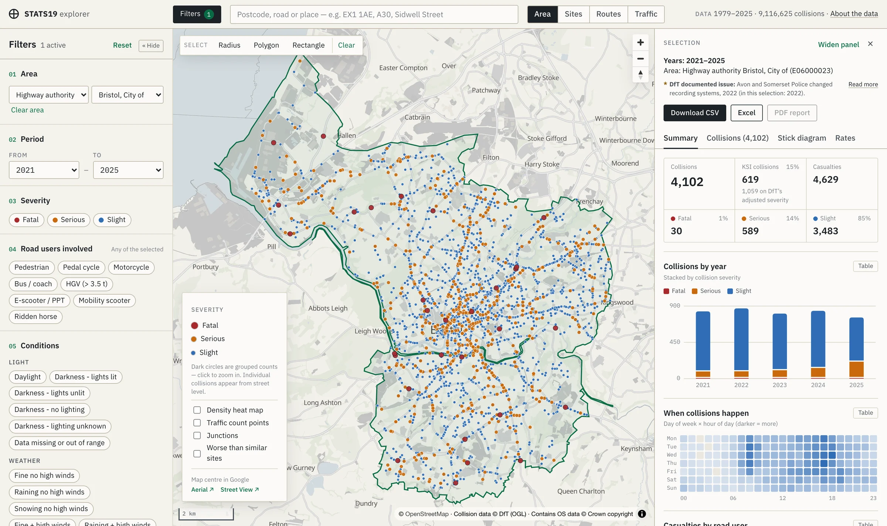
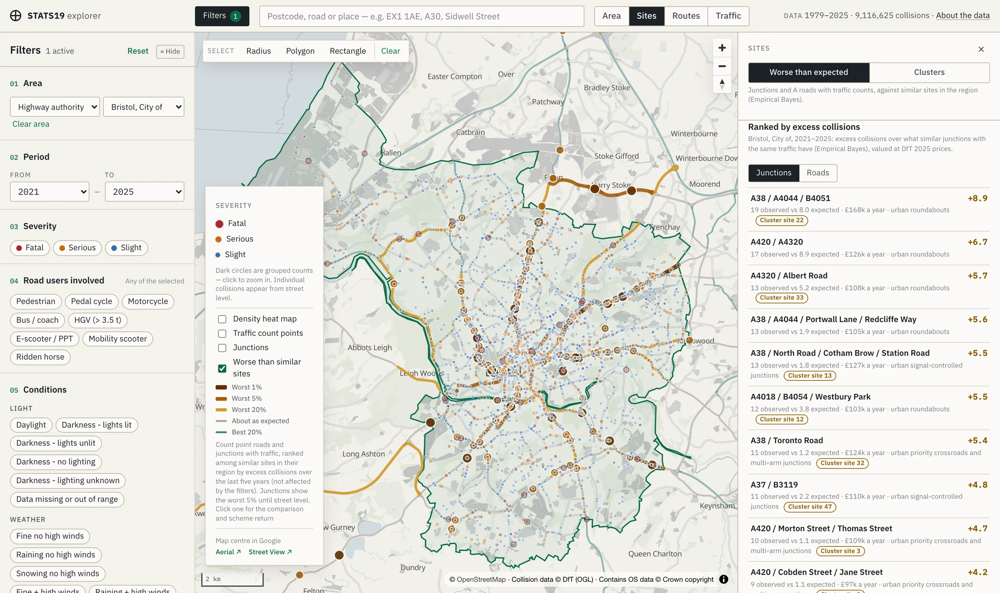
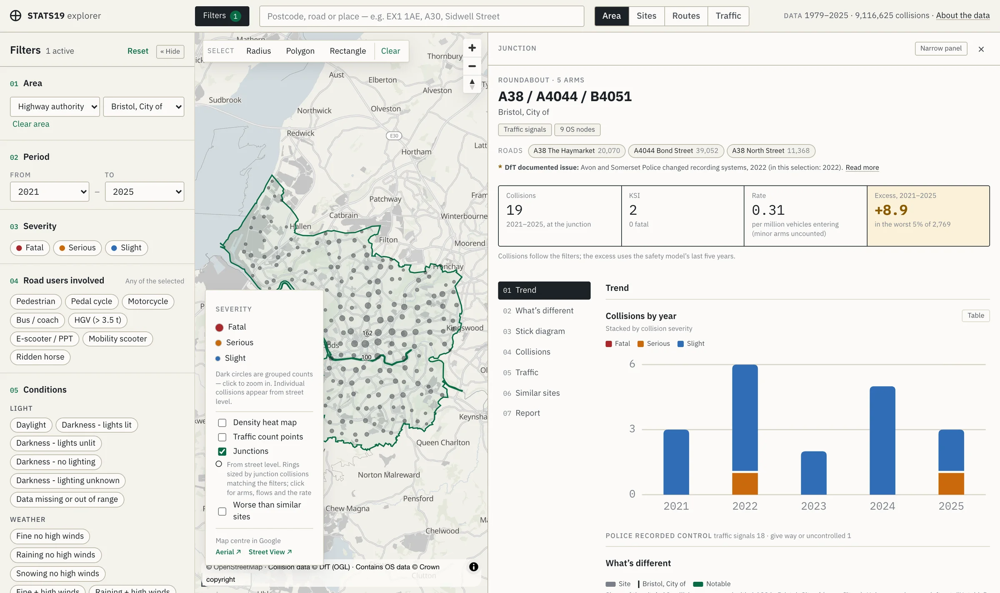
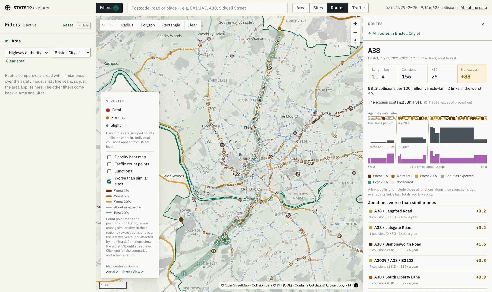
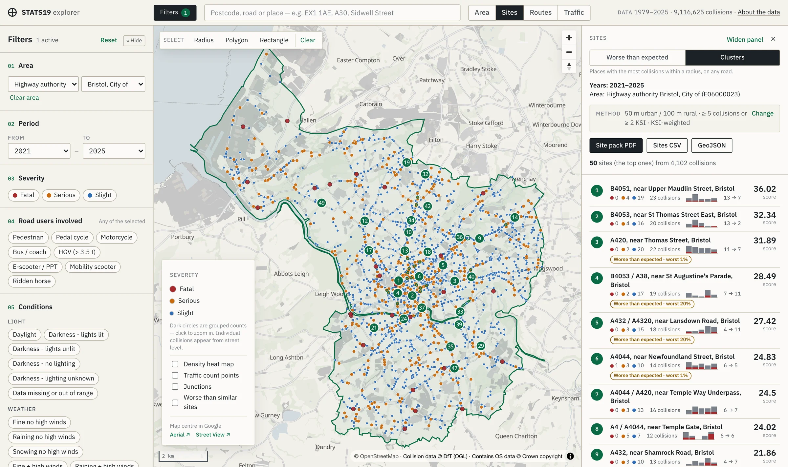
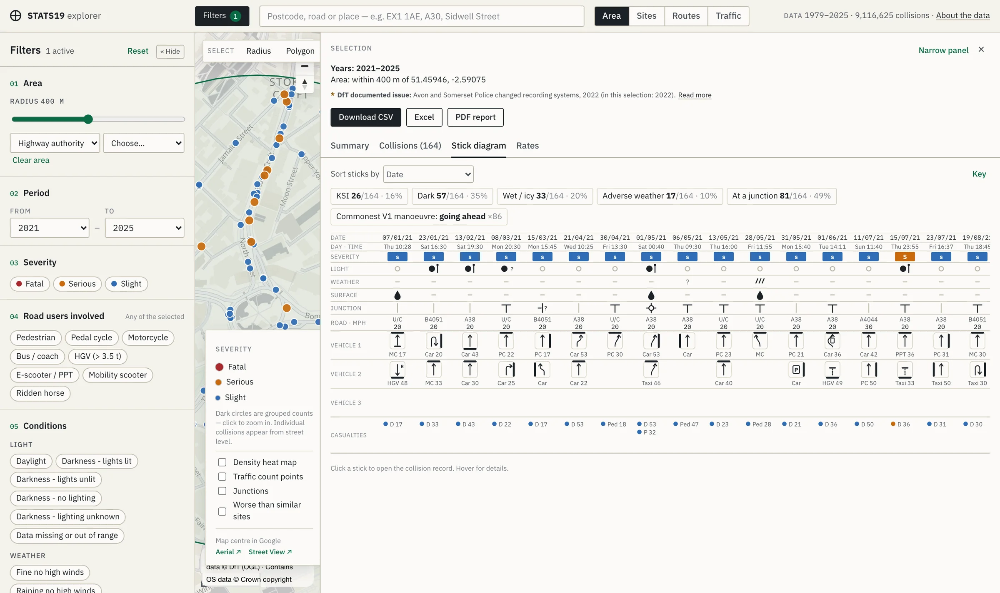
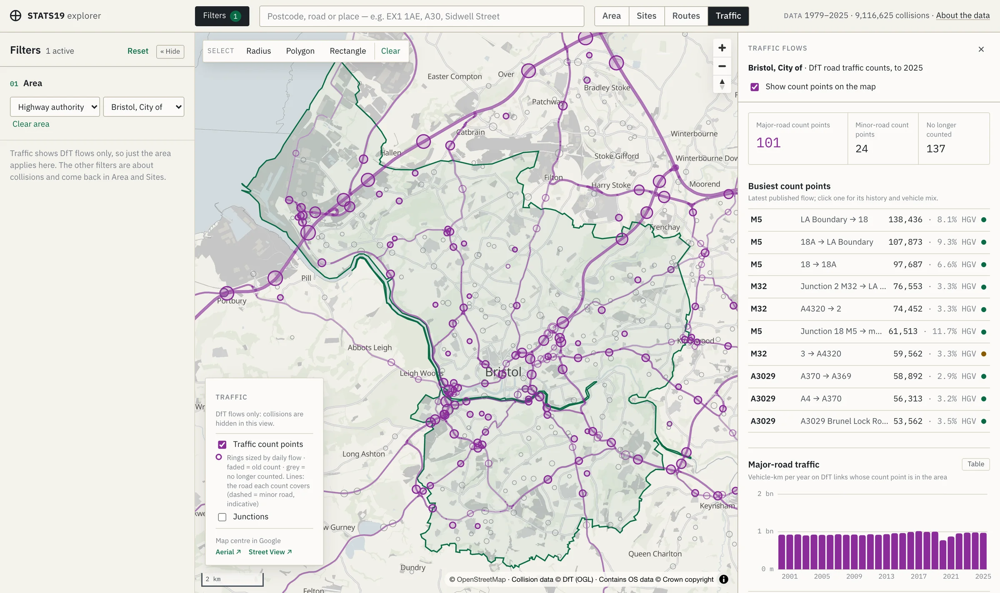
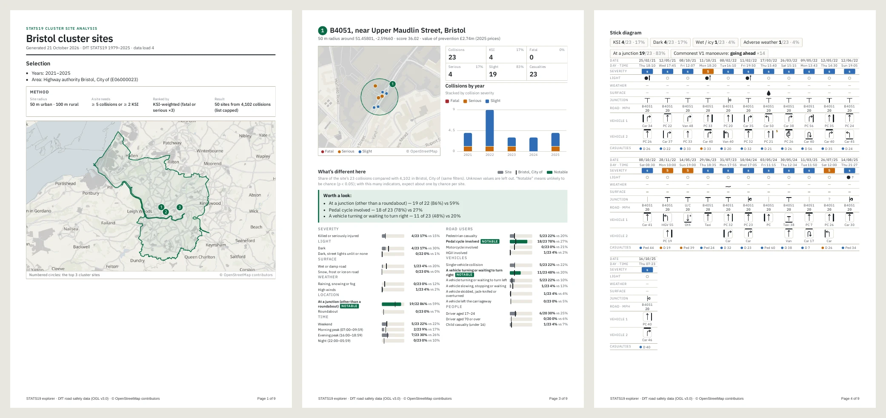
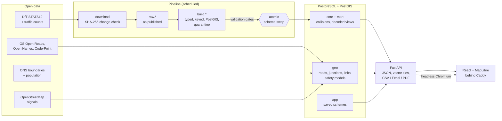

# STATS19 explorer

**A road-safety analysis platform for highway engineers, built on 47 years of UK police collision data.**

It pulls the Department for Transport's STATS19 data (9.1 million collisions, 1979–2025) into PostgreSQL + PostGIS by itself, checks every load, and joins it to the national road network, traffic counts and population. A React + MapLibre web app on top lets an engineer find dangerous junctions and roads, see what's different about them, and produce the stick diagrams and PDF site packs that UK road-safety work depends on.

[](https://github.com/benw312/stats19-explorer/actions/workflows/ci.yml)
[](LICENSE)




## Highlights

| | |
|---|---|
| **Data engineering** | Unattended ETL with change detection (publish date, then SHA-256), typed and keyed tables, validation gates, a quarantine for bad rows, and an **atomic schema swap**, so a failed load never touches live data. It runs on a schedule and records every run and check. |
| **Statistics** | **Safety performance functions** (negative binomial GLMs, statsmodels) for 20 peer groups and **Empirical Bayes** estimates for 143k junctions and road links. These separate sites that are really worse than similar ones from sites that just had a bad few years (regression to the mean). Also exact binomial tests for "what's different here" and Poisson intervals for small-count rates. |
| **Geospatial** | 3.96 M OS Open Roads links read straight from GeoPackage without GDAL. 1.0 M junctions built from the network with OpenStreetMap signals. 1.1 M collisions matched to road links with DfT's own method (99.1% matched). Vector tiles served from PostGIS, and a self-hosted PMTiles basemap. |
| **Domain** | Built the way a road-safety engineer works: cluster-site analysis, KeyACCIDENT-style stick diagrams, collision rates per 100 M vehicle-km, COBALT-style junction rates, and first-year rate of return (FYRR) at DfT values of prevention. It also evaluates schemes before and after. |
| **Web app** | React 19 + TypeScript + MapLibre. Shareable URL state, accessible charts (each with a table view, keyboard-focusable marks and a colour-blind-safe palette), and CSV, Excel and GeoJSON exports. |
| **Reports** | PDF area reports and site packs, rendered by headless Chromium from the app's own print pages, so screen and paper share one set of components. |
| **Ops and security** | One Docker Compose stack on a home server. Remote access goes through a **Cloudflare Tunnel + Access** (nothing opened on the router). The API checks the Access JWT at the origin and connects as a read-only database role. Scheduled backups, plus busy limits on PDF and export work. |
| **Testing** | 628 Python tests (unit, plus integration tests against a real PostGIS; 94% coverage) and 156 Vitest tests, all run by GitHub Actions on every push, with the PDF renderer in headless Chromium. Linted with ruff, oxlint and Prettier. Dependencies are watched by Dependabot. |

About 13.5k lines of Python and 15k lines of TypeScript, built since March 2025.

## Screenshots

**Area.** Every collision in a chosen area on the map, with headline figures, the yearly trend, when collisions happen, and who was hurt.



**Sites → worse than expected.** Junctions and roads ranked by excess collisions over similar sites with the same traffic (Empirical Bayes), with the cost of the excess at DfT values. The map bands every scored site from worst 1% to best 20%.



**Site page.** One page per junction, road or cluster site. It shows the roads and flows, headline figures, the trend, what's different against the authority, the stick diagram, traffic, the comparison with similar sites and a PDF.



**Routes.** One road as a corridor: its counted links in order from west to east, with the risk band, collisions per km and traffic flow on one distance axis, and the junctions along it that are worse than similar ones.



**Cluster sites.** Fixed-radius clusters centred on collisions, ranked KSI-weighted, with yearly sparklines. Sites that are also worse than expected are flagged.



**Stick diagram.** One column per collision: severity, light, weather, surface, junction, road and speed limit, a manoeuvre arrow per vehicle, and casualties. Re-sort it by any row to make patterns line up.



**Traffic flows.** DfT count points sized by daily flow, traced onto the OS roads each count covers, with vehicle mix, HGV share and the authority's traffic trend.



**PDF site pack.** A cover with the method and an area map, then each site's map, figures, "what's different here" and stick diagram.



## How it works



- **Change detection.** The pipeline checks the GOV.UK page's `public_updated_at`, then compares file hashes, so an unchanged release is never reloaded.
- **Atomic publish.** Each load builds a complete new copy in schema `build`. If every blocking check passes, `build` and `mart` replace the live schemas in one transaction. A failed load leaves them untouched.
- **Bad rows go to quarantine.** Rows that would break a key go to `core.quarantine` with a reason, rather than failing the load.
- **Nothing is inferred.** `mart` holds only decoded or counted recorded data. Where DfT left gaps, they stay gaps, and the field catalogue says which years each field was recorded.
- **Reference data refreshes itself.** The scheduler reloads any reference dataset older than 90 days, then rebuilds the junctions, link matches and safety models.

The full data model, with every table, its source and its size, is in [docs/DATA.md](docs/DATA.md).

## Features

- **Map:** collisions by severity (colour *and* size), grouped counts when zoomed out, a density heat map, and layers for traffic, junctions and "worse than similar sites". Aerial and Street View links open Google Maps.
- **Search:** postcode, road or place, typo-tolerant.
- **Filters:** period, severity, road users, light, weather, surface, hazards, speed limit, road class and type, junction, vehicle manoeuvre, impact and skidding, day of week and time window (it can cross midnight). Fields not recorded for the whole period say "recorded from …". The whole state is in the URL.
- **Areas:** draw a radius, polygon or rectangle, or pick a highway authority, district or police force.
- **Views:** **Area** (what happened), **Sites** (where to act), **Routes** (one road as a corridor), **Traffic** (flows only, for design).
- **What's different here:** 26 recorded-field indicators (dark, wet, junction, peaks, road users, manoeuvres, driver age …). Each compares the site's share with the area's and is flagged "notable" by an exact binomial test.
- **Compared with similar sites:** each major road and counted junction is scored against its peer group, with separate levels for London, Scotland, Wales and the rest of England (police forces record at very different rates). It has a scheme-return (FYRR) calculator.
- **Junctions:** type, arms with their DfT counts, signals and mini-roundabouts from OpenStreetMap, and the rate per million vehicles entering.
- **Collision context:** sun position and vehicle headings for every collision, so glare can be checked.
- **Schemes:** save a scheme and evaluate it before and after, with Empirical Bayes and yearly calibration.
- **Exports:** CSV zip (collisions, vehicles, casualties, with codes and labels plus a README of the selection), Excel, GeoJSON for GIS, and PDF reports.
- **About the data:** DfT's documented recording issues, gaps the app detects, and how figures are counted, shown wherever they affect a selection.

## API

`stats19 serve` (or the `api` compose service) serves FastAPI on port 8000. In Docker, Caddy fronts it at `http://localhost:8080/api`, with interactive docs at `/api/docs`. Every response uses the envelope `{success, data, error}`. `f` is one JSON filter that every endpoint shares.

| Endpoint | |
|---|---|
| `GET /api/meta` | Data coverage, last run, reference freshness, limits, field catalogue (drives the filters) |
| `GET /api/search?q=` | Postcodes, places, roads, schools |
| `GET /api/tiles/collisions/{z}/{x}/{y}.mvt?f=` | Filtered collision vector tiles |
| `GET /api/summary?f=` · `/api/collisions?f=` · `/api/collisions/{id}` | Summary statistics, paged list, one decoded record |
| `GET /api/sticks?f=` | Stick-diagram data |
| `GET /api/hotspots?f=&p=` (`.csv`, `.geojson`) | Ranked cluster sites |
| `GET /api/safety/top?unit=&sort=` | Junctions or roads ranked by Empirical Bayes excess |
| `GET /api/routes` · `/api/routes/{road}` | Roads ranked by excess or rate; one road as a corridor |
| `GET /api/junctions/{id}` · `/api/traffic/points/{id}` | Junction and count-point detail |
| `GET /api/compare?f=&base=` | Over-representation indicators, selection vs base |
| `GET /api/export/collisions.zip?f=` · `.xlsx?f=` | Exports |
| `GET /api/reports/area.pdf` · `sites.pdf` · `junction/{id}.pdf` · `road/{id}.pdf` · `collision/{id}.pdf` | PDF reports |

## Quick start

```bash
cp .env.example .env            # set POSTGRES_PASSWORD (and the matching URL)
scripts/fetch_basemap.sh        # once: OSM basemap for GB (~3 GB, ~15 min)
docker compose up -d            # PostGIS, scheduler, API, web app on :8080
docker compose run --rm pipeline run                  # load STATS19 now
docker compose run --rm pipeline refresh-reference    # roads, traffic, boundaries, models
docker compose run --rm pipeline status               # recent runs and check results
```

For local development:

```bash
uv sync
docker compose up -d db
set -a; . ./.env; set +a
uv run stats19 run                     # load the data
uv run stats19 serve                   # API on :8000
cd web && npm install && npm run dev   # app on :5173, proxies /api to :8000
```

The home-server runbook (install, updates, backups, debugging and remote access through Cloudflare) is in [docs/DEPLOY.md](docs/DEPLOY.md).

## Tests

```bash
uv run pytest                                   # unit tests
docker compose exec db createdb -U stats19 stats19_test    # once
export STATS19_TEST_DATABASE_URL=postgresql://stats19:<pw>@localhost:5432/stats19_test
uv run pytest --cov                             # + integration tests against PostGIS (wipes that database)
uv run playwright install chromium              # once, for the PDF renderer tests
uv run ruff check src tests && uv run ruff format --check src tests

cd web && npm test && npm run lint && npm run format:check && npm run build
```

## Project layout

```
src/stats19/            pipeline: sources, download, guide, load, transform, validate, marts, CLI
src/stats19/api/        FastAPI routes: filters, tiles, summary, exports, sticks, sites, routes, reports
src/stats19/reference/  OS / ONS / DfT / OSM loaders, junction and link builds, safety models (geo schema)
src/stats19/sql/        migrations and the core build (keys, geometry, indexes)
tests/                  unit and integration tests
web/                    React + TypeScript + MapLibre app (src/print/ = PDF pages)
docker/                 images, Caddyfile, backup script
docs/                   data model, deployment runbook, design plans, follow-ups
legacy/                 the original hand-run SQL this project grew from
```

## How it was built

Each major phase started with a written plan in [`docs/plans`](docs/plans): the problem, the options, the decisions and the reasons for them. Some examples: the [cluster-site method](docs/plans/PLAN-005-hotspot-sites.md), the [traffic and safety models](docs/plans/PLAN-008-traffic-flows.md), [remote access](docs/plans/PLAN-006-remote-access.md) and [schemes](docs/plans/PLAN-011-schemes.md). Open questions, known limits and rejected ideas are logged as numbered follow-ups in [docs/FOLLOWUPS.md](docs/FOLLOWUPS.md). For example, derived collision types were rejected because they would present guesses as recorded facts (FU-001).

## Feedback

Issues and suggestions are welcome; see [CONTRIBUTING.md](CONTRIBUTING.md). To report a security problem, please use the private route in [SECURITY.md](SECURITY.md) rather than a public issue.

## Data and licence

The code is licensed under the [GNU Affero General Public License v3.0](LICENSE).

The data is open data. It contains public sector information licensed under the [Open Government Licence v3.0](https://www.nationalarchives.gov.uk/doc/open-government-licence/version/3/): [DfT road safety data](https://www.gov.uk/government/statistical-data-sets/road-safety-open-data), [DfT road traffic statistics](https://roadtraffic.dft.gov.uk/downloads), Ordnance Survey open data (© Crown copyright and database right) and ONS geography. Traffic signals and the basemap are © OpenStreetMap contributors, under the ODbL.

---

Built by Ben Wallbridge.
